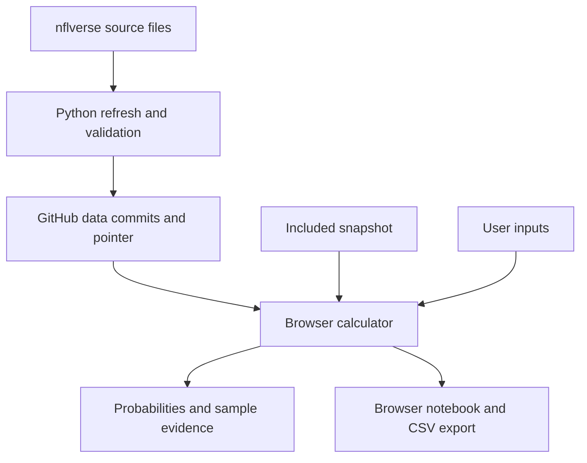

# Gridiron technical documentation

[Project README](../README.md) · [App and command guide](../gridiron-app/README.md) · [Contributing and publishing](PUBLISHING.md)

This guide describes the implemented `ridge-normal-v1` game model and snapshot schema version `1`. It covers the application under `gridiron-app`; the original analysis notebooks are independent. Implementation reviewed October 28, 2026.

## Architecture

The runtime is a static web app. JavaScript computes probabilities in the visitor's browser. Python runs separately to download data, build histories, train the game model, and write JSON. GitHub Actions runs that pipeline without the app or the owner's computer being open.



### Components

Paths below are relative to the repository root.

| Component | Responsibility |
| --- | --- |
| `gridiron-app/web/index.html` | Application controls, results, dialogs, and accessible labels. |
| `gridiron-app/web/styles.css` | Responsive layout, visual styling, and motion behavior. |
| `gridiron-app/web/app.mjs` | Form state, rendering, SVG distributions, odds comparison, saved scenarios, copy, and CSV export. |
| `gridiron-app/web/model.mjs` | Pure probability functions, sample statistics, Wilson intervals, input validation, and expected-value calculations. |
| `gridiron-app/web/historical.mjs` | Snapshot loading, immutable feed resolution, player filtering, historical auto-fill, and model report. |
| `gridiron-app/gridiron/refresh.py` | Source downloads, regular-season filtering, normalization, history construction, provenance, and staged JSON output. |
| `gridiron-app/gridiron/training.py` | Franchise aliases, chronological rolling features, Elo, ridge regressions, calibration, and evaluation. |
| `gridiron-app/gridiron/validate.py` | Snapshot integrity, numerical values, record counts, and chronological split checks. |
| `.github/workflows/gridiron-ci.yml` | App and pipeline checks on matching pushes and pull requests. |
| `.github/workflows/gridiron-refresh.yml` | Unattended refresh, validation, data/pointer commits, and static artifact upload. |

### Environments

| Task | Requirements |
| --- | --- |
| Use the hosted app | Modern browser; authorized ChatGPT account for this private instance. |
| Serve the app locally | Python 3 standard library and a modern browser. |
| Refresh/train locally | Python 3.12 recommended, matching CI; pinned dependencies from `gridiron-app/requirements.txt`. |
| Run JavaScript tests | Node 22, matching CI. |

There is no npm build, application database, server-side prediction endpoint, or sports-provider API key. The runtime assets are ordinary HTML, CSS, `.mjs`, SVG, and JSON. A static host must serve JavaScript modules with an appropriate JavaScript MIME type. Browsers must support ES modules, `fetch`, `AbortSignal.timeout`, and modern array methods such as `toReversed`.

## Data inputs and definitions

### Sources

| Dataset | URL used by the pipeline |
| --- | --- |
| Games and schedules | `https://raw.githubusercontent.com/nflverse/nfldata/master/data/games.csv` |
| Weekly player statistics | `https://github.com/nflverse/nflverse-data/releases/download/stats_player/stats_player_week_{season}.csv.gz` |

The player input is the `stats_player` weekly release, not the legacy `player_stats_{season}` naming scheme. Requests use a descriptive user agent and a 45-second timeout. Downloads are limited to 40,000,000 bytes per response. Transient download failures are retried up to three attempts; a 404 is handled separately.

Raw player downloads are cached in `.cache/gridiron` by default. Without `--force`, seasons earlier than `through - 1` can reuse existing cached bytes. Schedules are always fetched. The scheduled workflow passes `--force` so historical corrections can be incorporated.

### Coverage and eligibility

- Default completed-game history starts in 2015; player history starts in 2021. Both extend through the current NFL season. January and February map to the previous NFL season.
- Only `REG` games and player records enter this app. Postseason and preseason records are excluded.
- Completed games need both final scores, a recognized franchise, and a game date no later than the refresh date. Duplicate game IDs and invalid final scores fail normalization.
- Upcoming fixtures are uncompleted regular-season schedule entries dated from the refresh date through the next 28 days. Their future scores are not used for training.
- Player records are limited to QB, RB, FB, WR, and TE. Each record must join to a completed schedule game, and its team must match one of that game's teams.
- Duplicate player/game keys fail normalization. Direct imported stat values must be finite integers within the pipeline's bounds; the imported receptions, completions, and passing-TD fields must be nonnegative.
- Recorded zeros and negative yardage are retained. A missing appearance or DNP is not synthesized as a zero-stat game. Historical samples therefore describe source-recorded appearances, not every scheduled team game.
- A 404 for the latest requested player season produces a manifest warning and uses available earlier seasons. A 404 for an earlier requested season fails the refresh. The pipeline requires usable player history.

Franchise aliases are normalized: `LA`/`STL` → `LAR`, `SD` → `LAC`, `OAK` → `LV`, and `JAC` → `JAX`.

The derived `scoring_tds` field is `rushing_tds + receiving_tds`. It excludes passing, return, defensive, and fumble-recovery touchdowns. Passing touchdowns remain a separate supported stat.

### Snapshot files

All paths in this table are inside `gridiron-app/web/data/`.

| File | Contract |
| --- | --- |
| `latest.json` | Feed pointer with a `commit` field containing a 40-character lowercase hexadecimal Git commit SHA. Written by the publishing workflow after the data commit exists. |
| `manifest.json` | Schema and snapshot versions, generation time, source coverage, source URLs/hashes, counts, warnings, row columns, sample definition, and attribution. |
| `models.json` | Matching snapshot version, as-of date, feature names, trained margin/total models, team profiles, upcoming fixtures, evaluation, and limitations. |
| `player-index.json` | Matching snapshot version and player metadata used for selection and filtering. |
| `players-<TEAM>.json` | Matching snapshot version and player histories keyed by player ID. A player's entire loaded history is stored under the latest recorded team. |

`latest.json` is a publishing artifact, not an output of the Python refresh function itself. The remaining data files share the same `version`. The version combines a UTC generation timestamp and a digest derived from source URLs and SHA-256 hashes; a new run can have a new version even when the underlying source bytes are unchanged.

Player metadata fields are `id`, `name`, `position`, `team`, `last_date`, `last_season`, and `games`. Player history rows are arrays whose positions are defined by the manifest's `row_columns`:

| Index | Column | Meaning |
| --- | --- | --- |
| 0 | `season` | NFL season year. |
| 1 | `week` | Source regular-season week. |
| 2 | `date` | Completed game date, `YYYY-MM-DD`. |
| 3 | `team` | Normalized team for that appearance. |
| 4 | `opponent` | Normalized opponent. |
| 5 | `passing_yards` | Recorded passing yards. |
| 6 | `rushing_yards` | Recorded rushing yards. |
| 7 | `receiving_yards` | Recorded receiving yards. |
| 8 | `receptions` | Recorded receptions. |
| 9 | `completions` | Recorded passing completions. |
| 10 | `passing_tds` | Recorded passing touchdowns. |
| 11 | `scoring_tds` | Derived rushing plus receiving touchdowns. |

Consumers should use `row_columns` to find a stat rather than assume a new field can be appended without coordinating the schema and browser code. Team metadata reflects the latest recorded appearance; it does not establish a current contract, active roster spot, injury status, or starting role.

## Pipeline execution and output safety

1. Resolve seasons and the refresh date using UTC.
2. Fetch schedules, validate their required columns, and select completed and upcoming regular-season games.
3. Fetch each requested player-season file, validate its schema, and normalize only appearances joined to completed games.
4. Construct chronological game features; fit the training models, calibrate their residuals, and evaluate the held-out period.
5. Group and sort player histories, build the index, compute source cutoffs, and record provenance and warnings.
6. Write complete JSON files to a sibling staging directory with non-finite JSON values prohibited.
7. Rename the previous output aside, install the staged directory, and restore the previous directory if that installation fails. Remove the temporary backup after successful installation.
8. Run the standalone snapshot validator. In GitHub Actions, no data or pointer is pushed unless this check succeeds.

Download, normalization, and training failures occur before output replacement. The directory swap protects against partial files on disk, but it is not a substitute for running the separate validator. A local refresh followed by a failed validation may need restoration from Git or a previously retained copy. The publishing workflow preserves the last remote feed when a download, check, or push fails.

For CLI flags, virtual-environment setup, and the exact working directories, use the [app command guide](../gridiron-app/README.md#refresh-or-backfill-locally). `--through` limits completed-game/player-stat history; it is not a reconstruction of which source corrections were available at a historical point in time.

## Game model

### Chronological features

Games are sorted by date and game ID. For each team, the pipeline maintains its prior ten completed games of points scored and allowed. A row enters model fitting only after both teams have at least four prior games. A game's outcome is appended to team history and Elo only after its feature row has been constructed.

| Feature | Definition |
| --- | --- |
| `home_venue` | `1` for the normal home venue, `0` for a neutral venue. |
| `elo_difference` | `(home Elo - away Elo) / 400`. |
| `home_scoring` | Mean home-team points scored over its previous ten recorded games. |
| `away_scoring` | Mean away-team points scored over its previous ten recorded games. |
| `home_allowed` | Mean home-team points allowed over its previous ten recorded games. |
| `away_allowed` | Mean away-team points allowed over its previous ten recorded games. |
| `rest_difference` | Home rest minus away rest, capped to ±14 days and divided by 7. Missing rest defaults to 7 days per team. |

Team Elo starts at 1500. At an observed season transition, ratings regress toward 1500 by multiplying their deviations by `0.67`; rolling scoring history carries across seasons. The expected home result uses a 55-point home-venue Elo adjustment, the update factor is `20`, and an actual tie is scored as `0.5`.

### Training and calibration

Two ridge regressions predict `home_score - away_score` and `home_score + away_score`. The pipeline needs at least 500 usable rows and 100 distinct game dates.

Unique game dates are divided chronologically into approximately 75% training, 12.5% calibration, and 12.5% held-out testing. These are date partitions, so game counts need not match those exact percentages. Same-date games stay in the same period.

For each target:

1. Fit `StandardScaler` on training features only.
2. Fit `Ridge(alpha=20)` on standardized training features.
3. Convert the coefficients back to raw feature units for browser inference.
4. Use mean calibration residual as an intercept correction.
5. Use the root mean squared centered calibration residual as the normal SD, floored at one point.

Held-out outcomes are excluded from coefficient fitting and residual calibration. Earlier held-out game results can enter later held-out rolling features, matching a sequential forecasting setup. Published team profiles include all completed games in the snapshot, while forecasts use the evaluated coefficients; there is no final refit on the held-out outcomes.

If the fitted margin is `M` and total is `T`, the browser displays:

```text
home projected points = (T + M) / 2
away projected points = (T - M) / 2
```

Margin and total use separate fitted residual SDs. The engine does not simulate individual drives or discrete football scoring combinations.

### Evaluation

The report is stored in `models.json.evaluation` and displayed by **Model backtest**.

| Metric | Interpretation |
| --- | --- |
| `win_brier` | Mean squared error of predicted home-win probability against a binary home-win outcome. Ties count as not a home win. Lower is better. |
| `baseline_brier` | Same score for the constant training-period home-win rate. |
| `win_log_loss` | Binary home-win log loss, with probabilities clipped for numerical stability. |
| `margin_mae`, `total_mae` | Mean absolute prediction error in points on held-out games. |
| `margin_80pct_coverage` | Fraction of held-out margins within the normal model's central 80% range. |
| `calibration_bins` | Mean predicted and observed home-win frequencies in populated probability bins, with sample counts. |

Training, calibration, and test date ranges and counts are also stored. A refresh can change both source records and split boundaries, so successive metrics are not necessarily comparisons on an identical fixed benchmark. This is a game-model evaluation; it does not validate the player-stat or touchdown forecasts, and it does not reconstruct historical injury or source-availability information.

## Probability calculations

### Normal events, integer results, and pushes

Let `F(x)` be the fitted normal CDF with mean `mu` and SD `sigma`. For an integer-valued outcome `X` and threshold `t`, the engine uses continuity corrections:

```text
P(X > t) = 1 - F(floor(t) + 0.5)
P(X < t) = F(ceil(t) - 0.5)
P(X = t) = F(t + 0.5) - F(t - 0.5), when t is an integer
```

A non-integer line has zero push probability. For ordinary over/under events, successful outcome, opposite outcome, and push sum to one within numerical precision.

Home wins use margin above zero; away wins use margin below zero. For home spread `s`, home cover means margin greater than `-s`. For example, `s = -3` means a margin of exactly three is a push. Totals use the fitted total mean and SD.

The JavaScript CDF is a numerical approximation. The displayed central 80% model range describes assumed outcome variability, not a confidence interval for the predicted percentage.

### Player estimates

The selected player's history is filtered by season first, then truncated to the most recent selected number of appearances. Historical auto-fill requires at least three matching appearances. The mean is equally weighted; sample SD uses the `n - 1` denominator.

| Stat | Distribution / parameters |
| --- | --- |
| Passing, rushing, receiving yards | Normal using sample mean and SD. The browser floors the supplied SD at one unit; constant samples are explicitly noted. |
| Receptions, completions, passing TDs | Poisson with rate equal to the selected sample mean. |
| Rushing plus receiving TDs | Poisson with rate equal to the selected sample mean of `scoring_tds`. |

The optional player adjustment changes the expected mean to `mean × (1 + adjustment / 100)`; it does not change the supplied yardage SD. Initial player lines are set near the sample mean. There is no automatic opponent, usage, role, injury, or weather adjustment.

### Poisson counts

For nonnegative count `k` and rate `lambda`:

```text
P(X = k) = exp(-lambda) × lambda^k / k!
P(X >= k) = 1 - P(X <= k - 1)
P(X >= 1) = 1 - exp(-lambda)
```

The engine handles a zero rate explicitly. Integer over/under lines retain their exact-count push probability. Touchdown events support zero, exactly the selected count, and at least the selected count.

### Historical hit rates and intervals

The empirical check counts successes among the selected recorded appearances using the selected event condition. Its hit rate is `k / n`; pushes remain in the denominator and are reported separately. The displayed 95% Wilson interval describes uncertainty in that historical hit rate. It is not an uncertainty interval for the fitted model's future probability.

### Optional American odds comparison

Entered odds are user assumptions. Positive American odds `A` convert to decimal `1 + A/100`; negative odds convert to `1 + 100/abs(A)`. Break-even probability is `1/decimal`.

With a possible push, the comparison uses `P(win) / (1 - P(push))` for the settled-event edge. Expected net return per 100 units staked is:

```text
100 × [P(win) × (decimal - 1) - P(loss)]
```

Pushes return the original stake. There is no live price feed or transaction capability.

## Immutable feed publishing contract

The frontend's configured base is:

```text
https://raw.githubusercontent.com/aclao89/NFL_Stats/main/gridiron-app/web/data/
```

On startup, `historical.mjs` renders the bundled manifest, model, and index, then tries the remote feed. A remote load:

1. Reads `latest.json` on `main` and checks the commit's 40-character lowercase hexadecimal format.
2. Replaces the `/main/` path segment with that commit SHA.
3. Reads `manifest.json`, `models.json`, and `player-index.json` at the immutable commit.
4. Checks schema version `1` and matching snapshot versions.
5. Loads each selected player's team history from the same immutable base and checks its version.

Requests use `cache: no-store`, cache-busting query values, and an 18-second timeout. Correctness depends on immutable commit paths and version checks, not on a cache-busting query alone. Player chunks are cached in memory by snapshot version and latest-recorded team; in-flight selection tokens prevent an older player request from replacing a newer selection.

Each load attempts a complete source, then falls back to the bundled snapshot if needed. It does not combine a remote manifest with local player files. A cached pointer can select an older complete snapshot until GitHub's cache advances; source cutoffs and the snapshot build time remain visible. Manual scenarios remain available if no historical snapshot can load.

The workflow publishes in this order:

1. Refresh and validate `web/data/` in the checked-out `main` tree.
2. Commit the generated data and capture that commit SHA.
3. Write `web/data/latest.json` with that data commit's SHA and commit the pointer.
4. Push both commits to `main` together.

The pointer must reference the data commit that actually contains the intended manifest, model, index, and history files. It does not need to point to the final pointer commit. A local Python refresh recreates the snapshot directory and does not retain a working `latest.json`; use the workflow to publish, or reproduce this commit-and-pointer sequence after running all checks. Copying a pointer from a different snapshot does not publish new data.

To roll the feed back, point `latest.json` to a retained, previously validated data commit and publish that pointer through the normal review route. Keep schema compatibility with the deployed frontend. A rollback can restore a working snapshot while an upstream or pipeline problem is investigated.

## State, privacy, and exports

Saved scenarios use the `gridiron.scenarios.v1` local-storage key and a 24-item limit. Saved objects include an ID, mode, cloned input state, probability, push probability, distribution, title, subtitle, save time, example flag, and available historical summary. Input state carries historical basis information such as the snapshot version and sample date range.

Reload validates the saved inputs and switches historical auto-fill off before restoring them. It preserves the saved scenario inputs rather than replaying a newer team/player selection. CSV includes save time, scenario type, result labels, probability and push percentages, model kind, example flag, historical hits/games, and raw input JSON. There is no CSV import.

Scenarios are not sent to the data repository. Browser storage is specific to origin and browser profile; hosted and localhost notebooks are separate. Clearing storage removes the notebook. CSV export is the portable record. Labels are escaped when rendered, and exported CSV cells receive formula-prefix protection. These measures are separate from the hosting platform's access control.

The local app has no application account system. The hosted private instance adds its hosting platform's sign-in gate, while the public GitHub repository and public NFL-data feed remain independently accessible.

## Automation, deployment, and operations

### Workflow behavior

| Workflow | Trigger and permissions |
| --- | --- |
| App checks | Pushes and pull requests matching `gridiron-app/**` or `.github/workflows/gridiron-*.yml`; `contents: read`. |
| Data refresh | `17 12 * * 2,4`, manual dispatch, and matching pipeline pushes to `main`; `contents: write`. |

Refresh runs are serialized by the `gridiron-data-refresh` concurrency group, with running jobs preserved rather than cancelled, and have a 20-minute timeout. The job explicitly checks out and pushes to `main`. A non-fast-forward or branch-protection rejection fails the push; the workflow does not force-push. Its artifact contains `gridiron-app/web/` for inspection or separate static deployment.

The scheduled workflow must exist on the default branch and remain enabled. Scheduled execution may be delayed, and public-repository schedules can be disabled after inactivity. Check the workflow run, its publish step, and the resulting feed pointer when verifying freshness. A saved cron expression alone is not evidence that a run completed.

### Static deployment

Deploy the contents of `gridiron-app/web/` with `index.html` at the public root and correct MIME types. Serve modules and JSON over HTTP/HTTPS. If using a Content Security Policy, permit the configured raw GitHub origin for data reads. No prediction backend or data-provider secret is required by the browser.

The existing private hosted app serves the same frontend, with its own bundled snapshot. Published GitHub data can refresh the open app's history without redeploying the frontend. Changes to HTML, JavaScript, CSS, or hosted access settings require a separate hosting update; the data workflow does not perform that deployment.

For a fork or a branch rename, update `DEFAULT_REMOTE`, the literal `/main/` replacement used when resolving the pointer, workflow checkout/push/trigger refs, and documentation links together. If schema or probability behavior changes, update tests and coordinate the deployed frontend with the new snapshot format.

### Failure recovery

| Failure | Verification and response |
| --- | --- |
| Source download or schema failure | Inspect the failing season/URL and required columns. Retain the last remote feed and correct the pipeline before publishing. |
| Validation failure | Inspect manifest versions, row counts, chronology, and finite model outputs. Do not bypass the check or publish individual repaired files into a different snapshot. |
| GitHub push failure | Inspect branch protections, token permissions, and concurrent commits. Rebase/re-run through the normal repository workflow; preserve the working feed. |
| Browser uses included data | Confirm `latest.json` resolves to a reachable data commit and compatible files. Check for updates after cache propagation or connection recovery. |
| Fresh build with old source cutoff | Read separate game/player cutoffs and warnings; inspect upstream publication status before assuming new records exist. |
| Bad published snapshot | Repoint the feed to a previously validated data commit, then repair and re-run the pipeline. |
| Lost scenarios | Check the original browser and origin; use prior CSV exports as the record. There is no server-side scenario backup. |

## Verification and maintenance

The current automated suite comprises five Python tests and twelve Node tests. Python cases exercise future/unfinished-game exclusion, duplicate/invalid records, feature leakage, missing/zero/negative player data, and franchise aliases. Node cases exercise all 992 distinct home/away pairings, sample selection, normal/Poisson probabilities, conservation, spread signs, pushes, Wilson intervals, odds calculations, and invalid inputs.

The standalone validator checks manifest/model/index version agreement, disjoint ordered model periods, finite coefficients and positive SDs, player-index/chunk agreement, row shapes and ordering, duplicate season/week appearances, stat types, and counts. Run it with normal Python execution: its checks use assertions.

Use the [documented commands](../gridiron-app/README.md#run-checks) from `gridiron-app`. For a frontend or feed change, also check in a real browser that published data loads, a player history applies, an edited projection turns auto-fill off, and a saved scenario restores its original inputs. CSV export should preserve the saved probability and input JSON. Check frontend console errors and source cutoffs when investigating a loading problem.

Changes to model features, stat definitions, source schemas, dependencies, or data windows should be reflected in the model report and these documents. Game-model metrics can change when the held-out period changes. Player sample estimates remain a separate, unbacktested baseline until a dedicated chronological player evaluation is implemented.

## Attribution and references

The app credits nflverse/nflverse-data and nfldata, including schedules maintained by Lee Sharpe. Each manifest preserves attribution and source hashes. Upstream nflverse data is broadly published under CC BY 4.0 with dataset-specific exceptions described by nflverse; this app does not use FTN charting data. Refer to the actual input repositories and releases for their notices. This guide does not assign a software license to the application.

- [nflverse data and licensing](https://github.com/nflverse#licensing)
- [nflverse-data weekly player release](https://github.com/nflverse/nflverse-data/releases/tag/stats_player)
- [nflverse/nfldata](https://github.com/nflverse/nfldata)
- [Player-stat documentation](https://nflreadr.nflverse.com/reference/load_player_stats.html)
- [Source publication and correction schedule](https://nflreadr.nflverse.com/articles/nflverse_data_schedule.html)
- [GitHub schedule event behavior](https://docs.github.com/en/actions/reference/workflows-and-actions/events-that-trigger-workflows#schedule)
- [Python local HTTP server](https://docs.python.org/3/library/http.server.html)
- [scikit-learn Ridge](https://scikit-learn.org/stable/modules/generated/sklearn.linear_model.Ridge.html)
- [scikit-learn StandardScaler](https://scikit-learn.org/stable/modules/generated/sklearn.preprocessing.StandardScaler.html)
